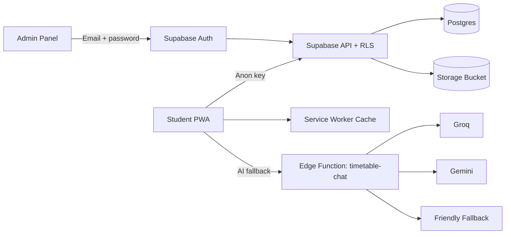

# 🎓 TrackClass

### Smart university timetables, free rooms, and teacher locations in one place.

TrackClass is a student-first timetable platform for **Fall 2026**. Students pick their section once and instantly get a live weekly timetable, free rooms, free slots, teacher locations, change notices, and a timetable-only AI assistant.

<div align="center">

[](https://react.dev)
[](https://www.typescriptlang.org)
[](https://vite.dev)
[](https://tailwindcss.com)
[](https://supabase.com)
[](https://vite-pwa-org.netlify.app)
[](#-verification)

[Features](#-features) • [Quick Start](#-quick-start) • [Supabase Setup](#-supabase-setup) • [Architecture](#-architecture) • [Scripts](#-scripts) • [Roadmap](#-roadmap)

</div>

---

## 🌟 Overview

TrackClass turns the official university Excel timetable into a clean, fast, and installable web app.

> **Current dataset:** 3 departments, 22 sections, 186 entries, and 43 free cells.

The app is built around three ideas:

- **Zero friction for students.** No account, no password. Pick a section and go.
- **Admin-controlled accuracy.** Only authenticated admins can upload and publish a new timetable version.
- **Graceful degradation.** Timetable pages and common assistant questions work offline. AI is an enhancement, not a dependency.

---

## ✨ Features

| Area | What TrackClass does |
| --- | --- |
| 📅 **Weekly timetable** | Clean five-day grid with course codes, subjects, teachers, and rooms. |
| ⚡ **Live class status** | Shows the current class, free period, or next class with a countdown. |
| 🚪 **Free room finder** | Pick any day and slot to see available rooms and sections without class. |
| 🧑‍🏫 **Teacher locator** | Search any teacher to see their full weekly route and current room. |
| 🤖 **Timetable assistant** | Answers in Roman Urdu using local logic first, then AI fallback. |
| 🔔 **Change notices** | Section-specific diff notices appear after a new version is published. |
| 📴 **Offline support** | Installable PWA with cached app shell, timetable data, and local answers. |
| 🛠️ **Admin publishing** | Upload `.xlsx`, review cell-level changes, publish, and keep version history. |
| 🔐 **Secure access** | Student reads use Supabase RLS. Admin actions require email/password auth. |
| 🎨 **Polished UI** | Dark cinematic interface, responsive tabs, section rail, and reduced-motion support. |

---

## 🧩 Tech Stack

| Layer | Technology |
| --- | --- |
| **Frontend** | React 18, TypeScript, Vite 6 |
| **Styling** | Tailwind CSS v4, custom design tokens, Framer Motion |
| **Fonts** | Manrope Variable, Space Grotesk Variable |
| **Backend** | Supabase Postgres, Auth, Storage, Edge Functions |
| **Data parsing** | SheetJS (`xlsx`) |
| **Time handling** | `date-fns-tz`, `Asia/Karachi` |
| **Testing** | Vitest |
| **Offline / PWA** | `vite-plugin-pwa`, Workbox |
| **Icons** | Lucide React |

---

## 🏗️ Architecture



**Publishing model**

1. Admin uploads the official workbook.
2. The browser parses the workbook and compares it with the active snapshot.
3. The original file is stored in Supabase Storage.
4. A Postgres RPC publishes the new version atomically.
5. The latest version and the previous version are retained.

**Freshness model**

TrackClass does not use Supabase Realtime. The client checks the active `content_hash` on load and when the window regains focus. If a newer version exists, a refresh banner appears.

---

## ⚡ Quick Start

### 1. Clone and install

```bash
git clone https://github.com/kasaam-ali/TrackClass.git
cd TrackClass
npm install
```

### 2. Run the local demo

```bash
npm run dev
```

Open the app and choose **Continue in demo mode**. The demo snapshot is bundled from `sample/timetable-fall-2026.xlsx`, so no backend keys are needed.

### 3. Rebuild the demo snapshot

After changing the parser or sample workbook:

```bash
npm run demo:snapshot
```

---

## 🔐 Environment Variables

Copy `.env.example` to `.env` and fill in your Supabase project values.

| Variable | Required | Purpose |
| --- | --- | --- |
| `VITE_SUPABASE_URL` | Yes for live mode | Supabase project URL |
| `VITE_SUPABASE_ANON_KEY` | Yes for live mode | Public anon key used by the browser client |

`.env` is gitignored. Never commit the service role key or provider secrets.

---

## 🗄️ Supabase Setup

1. Create a Supabase project.
2. Open the SQL editor and run:
   - `supabase/migrations/001_init.sql` for a fresh project.
   - `supabase/migrations/002_replace_timetable_safe.sql` only if an existing project hit the `pg-safeupdate` RPC error.
3. Copy `.env.example` to `.env` and set `VITE_SUPABASE_URL` and `VITE_SUPABASE_ANON_KEY`.
4. In Supabase Auth, create the admin user with email and password. Public signup is not used by the app.
5. Deploy the chat Edge Function:

```bash
supabase functions deploy timetable-chat
supabase secrets set GROQ_API_KEY=... GEMINI_API_KEY=... RATE_LIMIT_SALT=...
```

`RATE_LIMIT_SALT` is optional but recommended.

6. Restart the app:

```bash
npm run dev
```

The Edge Function uses Groq first, then Gemini, then a friendly fallback. Without provider keys, deterministic client answers still work.

---

## 🛠️ Admin Workflow

Sign in at `/admin/login`, then upload the official `.xlsx` at `/admin/upload`.

1. **Parse** the workbook in the browser.
2. **Review** parsed counts and a cell-level diff against the active version.
3. **Upload** the original file to the public `official_timetables` bucket.
4. **Publish** through the `replace_timetable` RPC.
5. **Retain** the new version and the previous version.
6. **Notify** students with section-specific change notices.

If the parsed workbook has no changes, publishing is disabled.

---

## 🤖 AI Assistant

The assistant is designed to be useful even when AI providers are unavailable.

1. **Local resolver first** - common questions about classes, free rooms, free slots, teachers, and changes are answered instantly.
2. **Edge Function fallback** - unmatched questions go to `timetable-chat`.
3. **Provider chain** - Groq with a 6 second timeout, then Gemini, then a friendly fallback.
4. **Rate limiting** - 10 requests per minute per hashed IP.
5. **Privacy conscious** - students do not need an account, and prompts are limited to timetable context.

Example questions:

```text
Meri agli class konsi hai?
Abhi kaunsa room free hai?
Friday ke free slots?
Sir Abid Ali kahan hain?
```

---

## 📁 Project Structure

```text
src/
  components/       Shared UI, dashboard, timetable, chat, and admin components
  context/          Profile, timetable, and admin auth providers
  data/             Bundled demo snapshot
  lib/chat/         Deterministic resolver, history, AI client
  lib/store/        Local demo store and Supabase store
  lib/timetable/    Parser, normalization, engines, and types
  pages/            Student dashboard, onboarding, and admin pages
supabase/
  functions/        timetable-chat Edge Function
  migrations/       Database schema, RLS, RPC, and patch migration
sample/             Source workbook for the demo
scripts/            Demo snapshot generator
public/             PWA icon
```

---

## 🧪 Verification

```bash
npm run typecheck
npm run test
npm run build
```

| Check | Result |
| --- | --- |
| TypeScript | ✅ Passes |
| Unit tests | ✅ 39 passing |
| Production build | ✅ Passes |
| Desktop UI | ✅ Verified |
| Mobile UI | ✅ No horizontal page overflow |
| PWA offline | ✅ Verified |
| Admin live flow | ✅ Verified |

The test suite covers parsing, cross-section engines, snapshot rebuilding, and the deterministic chat resolver.

---

## 📜 Scripts

| Command | Description |
| --- | --- |
| `npm run dev` | Start the Vite development server |
| `npm run build` | Typecheck and build for production |
| `npm run preview` | Preview the production build |
| `npm run typecheck` | Run TypeScript checks |
| `npm run test` | Run Vitest once |
| `npm run test:watch` | Run Vitest in watch mode |
| `npm run demo:snapshot` | Regenerate the bundled demo snapshot |

---

## 🧠 Data Notes

- The original `.xlsx` remains the source of truth.
- A slot cell can contain more than one course. Courses are split by course code and kept with `cell_index`.
- Period times vary by department and day. Periods are keyed by department, day, and slot.
- Teacher and room extraction is best effort. The raw cell text is always retained.
- The `Remaining Classrooms` footer row and break timings are not used in v1.
- The app stores the student section and chat history in `localStorage`.
- Supabase RLS exposes only the active version and active sections.

---

## 🚧 Roadmap

- [x] Live Supabase backend with RLS
- [x] Admin upload, diff, and publish flow
- [x] Installable PWA with offline support
- [x] Deterministic timetable assistant
- [x] AI Edge Function source
- [x] Responsive dark UI with motion
- [ ] Deploy the Edge Function with provider secrets
- [ ] Deploy the frontend to Netlify or Vercel
- [ ] Add end-to-end browser tests
- [ ] Add multi-term archive support

---

## 🤝 Contributing

Contributions are welcome.

1. Fork the repository.
2. Create a focused branch.
3. Keep the existing code style and English-only code comments.
4. Run `npm run typecheck`, `npm run test`, and `npm run build`.
5. Open a pull request with a clear summary and screenshots for UI changes.

Please avoid committing `.env`, service role keys, or provider secrets.

---

## 👤 Maintainer

Built and maintained by [@kasaam-ali](https://github.com/kasaam-ali).

<div align="center">

⭐ If TrackClass is useful, consider giving the repository a star.

</div>
